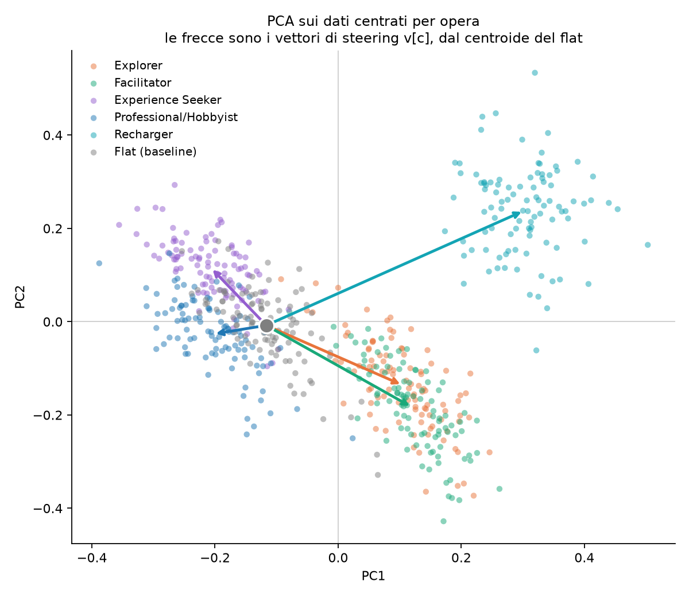
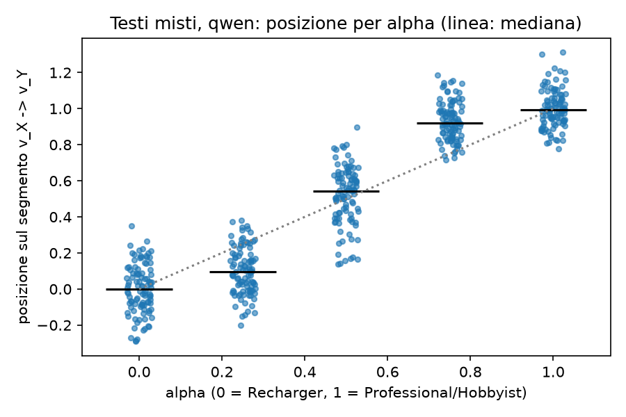
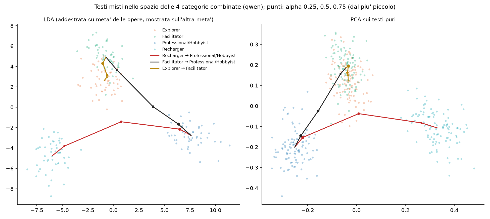
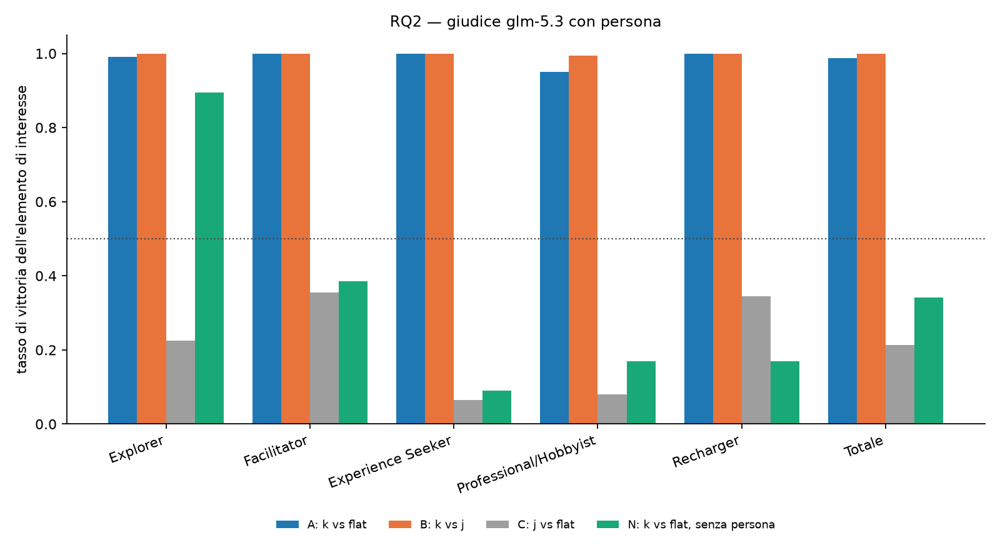
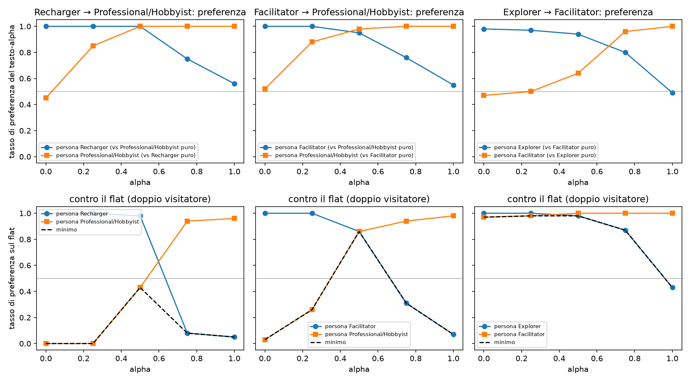

# Museumbot — parte 2: Gemma 4 31B e il profilo continuo

*Ultimo aggiornamento: 28 ottobre 2026. Il report descrive solo lo stato attuale del codice e
dei risultati; le decisioni nel tempo sono in `docs/decisioni.md`, la spec dell'esperimento
in `docs/plans/2026-10-06-profilo-continuo-design.md`. Numeri fra parentesi: embedding
BGE-M3 (fuori: Qwen3).*

**Domanda.** Con un modello aperto, Gemma 4 31B, di cui si controllano le distribuzioni sul
prossimo token, si possono generare testi *fra* due categorie di Falk, con un peso α. Il
report verifica che Gemma separi le categorie, poi chiede se i testi misti stanno davvero in
mezzo (RQ1) e se un giudice con persona li riconosce e li preferisce (RQ2).

## 1. Dati e pipeline

| passo | codice | output |
|---|---|---|
| testi puri | `generation/vllm_gen.py`, `kaggle/gen` | `data/local/generations.jsonl`: 600 `full` (5 categorie + flat) e 500 `full_rep` sulle 100 opere di `data/artworks.jsonl`, prompt di `common/prompts.py` più una riga contro il Markdown |
| testi misti | `generation/mixing.py`, `generation/vllm_mix.py`, `kaggle/mix-*` | `data/local/mixed.jsonl`: 940 testi, tre coppie × α = 0.25, 0.5, 0.75 × 100 opere più 60 del pilota |
| embedding | `rq1_embeddings/embed.py`, `mixed.py` | `data/emb/local/`, `data/emb/mixed/` |
| RQ1 | `analyze.py --corpus local`, `lexicon.py`, `repetition.py`, `mixed.py`, `mixed_space.py`, `generation/mix_diag.py` | `results/metrics_*_local.json`, `lexicon.json`, `repetition.json`, `mixed_*`, `mixed_space_*`, `mix_diag.json` |
| RQ2 | `rq2_judge/judge.py --corpus local`, `analyze.py --corpus local`, `mixed_judge.py`, `mixed_analyze.py` | `data/judgments_local.jsonl`, `data/judgments_mixed.jsonl`, `results/judge_glm-5.3_local.json`, `judge_mixed_glm-5.3.json` |
| esempi | `rq1_embeddings/mix_examples.py` | `docs/analisi/testi-misti-the-starry-night.{md,html}` |

Generatore: Gemma 4 31B QAT a 4 bit (`google/gemma-4-31B-it-qat-w4a16-ct`), vLLM 0.31.0 su
Kaggle (2× T4, float16, tensor parallel 2, patch al kernel di attenzione per le T4),
temperatura 0.7, ragionamento disattivato. Tutti i testi sono validi: 13 testi puri e 7
misti rimasti in violazione del filtro ("For those analyzing…", quasi sempre
Professional/Hobbyist) sono stati rigenerati in una seconda sessione con la stessa
configurazione.

## 2. Verifiche preliminari: Gemma separa le categorie?

Stessa batteria di analisi del report principale (§2) sui testi puri di Gemma, tutte e 6
le condizioni (`analyze.py --corpus local`, `results/metrics_*_local.json`).

**Lo shift c'è.** Probe a 6 classi 0.98 (0.975), caso 0.17, valutato su opere mai viste
(GroupKFold per opera). La condizione
spiega il 12.5% (4.5%) della varianza.

| Qwen3 (BGE-M3) | Explorer | Facilitator | Exp. Seeker | Prof./Hobbyist | Recharger |
|---|---|---|---|---|---|
| split-half | 0.96 (0.89) | 0.96 (0.88) | 0.95 (0.93) | 0.94 (0.90) | 0.98 (0.96) |
| tetto (replica) | 0.99 (0.98) | 0.99 (0.97) | 0.99 (0.99) | 0.99 (0.99) | 1.00 (0.99) |

Le soglie della spec fissate prima dei dati sono superate: probe sopra il caso in entrambi
gli embedding, split-half ≥ 0.6 per ogni categoria.

**Ripetitività** (`rq1_embeddings/repetition.py`, `results/repetition.json`; metodo nel
report principale, §3.6). Quota media di n-grammi in comune fra due testi della stessa
condizione su opere diverse (Jaccard), con il flat come riferimento.

| condizione | unigrammi | bigrammi | trigrammi | tutti |
|---|---|---|---|---|
| Recharger | 14.00% | 5.47% | 2.58% | 5.79% |
| Facilitator | 9.03% | 3.38% | 1.64% | 3.69% |
| Experience Seeker | 8.18% | 2.81% | 1.45% | 3.30% |
| Explorer | 7.78% | 2.37% | 1.00% | 2.83% |
| Prof./Hobbyist | 6.69% | 1.99% | 0.57% | 2.37% |
| flat | 5.57% | 1.45% | 0.43% | 1.86% |

Tutte le categorie ripetono più del flat. Il Recharger circa tre volte tanto, e sei volte
sui trigrammi, dove stanno le formule; il Professional/Hobbyist è il più vicino al flat.
Quali parole producono questa ripetizione lo dicono i termini distintivi, sotto.

**Termini distintivi** (`rq1_embeddings/lexicon.py`, `results/lexicon.json`; metodo nel report
principale, §3.6). Termini più distintivi per condizione, con la quota dei testi che li
contengono; *eco*: termini con una parola piena del blocco di categoria del prompt, sui 15
riportati.

| condizione | termini più distintivi | eco |
|---|---|---|
| Recharger | *let the* (0.92), *allow* (1.00), *stillness* (0.95), *quiet* (0.93), *fade* (0.80), *silence* (0.70), *away* (0.88), *peace* (0.61) | 2/15 |
| Facilitator | *your companions* (0.67), *your group* (0.56), *discuss* (0.59), *ask your* (0.34), *might notice* (0.33), *gather* (0.27), *painting together* (0.20) | 3/15 |
| Experience Seeker | *standing before one* (0.92), *iconic* (0.68), *legendary* (0.51), *definitive* (0.68), *cultural* (0.38), *art history* (0.45), *highlight of* (0.23) | 7/15 |
| Prof./Hobbyist | *scholarly* (0.49), *approach to* (0.42), *technical* (0.50), *executed* (0.37), *compare* (0.35), *critical* (0.30), *analyzing* (0.24) | 3/15 |
| Explorer | *you study* (0.36), *look closer* (0.40), *let your eyes* (0.32), *do you think* (0.39), *curiosity* (0.26), *hidden* (0.29), *you spot* (0.14) | 3/15 |

Molti termini distintivi compaiono in quasi tutti i testi della categoria (*allow* in tutti
i Recharger, *standing before one* nel 92% degli Experience Seeker). L'Experience Seeker è la condizione che
riprende di più il prompt (7 termini su 15: *iconic*, *cultural*, *impact*, …); le altre
da 2 a 3. Il flat non ha un lessico proprio: il suo termine più distintivo ha z = 3.5, quello delle
categorie da 5.5 (Explorer) a 11.5 (Recharger).

## 3. RQ1 sulle categorie combinate

Verificata la separazione (§2), l'analisi si restringe alle quattro categorie che entrano
nelle coppie dei testi misti: Explorer, Facilitator, Professional/Hobbyist, Recharger.

**Probe a 4 classi** sui testi puri, centrati sulla media delle quattro categorie della
stessa opera e valutati fuori dal fold per opera (`rq1_embeddings/mixed_space.py`): 1.00
(0.99), caso 0.25.

**Direzione e distanza** (`metrics_*_local.json`). Il coseno fra gli steering vector
(riferimento flat) dice se due categorie spostano il testo nella stessa direzione (+1), in
direzioni indipendenti (0) o opposte (−1); la distanza cross-validata (report principale
§2) tiene conto anche di quanto lo spostano.

| coppia | coseno | distanza |
|---|---|---|
| Explorer – Facilitator | +0.79 (+0.69) | 0.045 (0.011) |
| Explorer – Professional/Hobbyist | +0.02 (+0.15) | 0.166 (0.042) |
| Explorer – Recharger | +0.48 (+0.52) | 0.197 (0.059) |
| Facilitator – Professional/Hobbyist | −0.06 (+0.10) | 0.205 (0.040) |
| Facilitator – Recharger | +0.39 (+0.39) | 0.236 (0.070) |
| Professional/Hobbyist – Recharger | −0.07 (−0.04) | 0.345 (0.115) |

Nessuna coppia ha direzioni opposte. Professional/Hobbyist–Recharger è la coppia più
distante in entrambi gli embedding: direzioni quasi indipendenti (coseno −0.07, −0.04) e lo
spostamento più ampio, quello del Recharger. Facilitator–Professional/Hobbyist ha direzioni
quasi indipendenti solo con Qwen3 (−0.06; +0.10 con BGE-M3) e una distanza intermedia; la
coppia più vicina è Explorer–Facilitator. Lo split-half delle quattro categorie va da 0.94
a 0.98 (0.88–0.96), il tetto dalla replica da 0.99 a 1.00 (0.97–0.99).

## 4. RQ1 sui testi misti

Passo 3 della spec. Un testo "fra" le categorie X e Y con peso α si genera con due esperti,
i prompt di X e di Y, e a ogni token si campiona dalla media dei loro logit con pesi
(1 − α, α), cioè dalla media geometrica pesata delle distribuzioni
(`generation/mixing.py`). Su vLLM la miscela si fa da fuori: a ogni passo una chiamata da
un token per esperto con le prime 100 log-probabilità, i token assenti dalla lista di un
esperto prendono il minimo della sua lista (`generation/vllm_mix.py`). Analisi in
`rq1_embeddings/mixed.py` (`results/mixed_{qwen,bge-m3}.json`): ogni testo, centrato sul
flat della sua opera, si proietta sul segmento fra gli steering vector v_X e v_Y del corpus
`local` (posizione 0 su X, 1 su Y), con il residuo fuori dal piano (v_X, v_Y) in rapporto
alla norma.

**Corpus misto** (`data/local/mixed.jsonl`, 940 testi, tutti validi): tre coppie scelte
prima dei dati con il coseno fra gli steering vector (§3), Recharger–Professional/Hobbyist e
Facilitator–Professional/Hobbyist, dette qui **contrapposte** (coseno più basso: direzioni
quasi indipendenti, non opposte), ed Explorer–Facilitator, **vicine** (coseno più alto),
α = 0.25, 0.5, 0.75 sulle 100 opere; più
60 testi del pilota (Recharger–Professional/Hobbyist, α = 0, 0.5, 1, prime 20 opere). I
vertici delle curve sono i testi puri del corpus `local`. 7 testi rimasti in violazione del
filtro sono stati rigenerati in una seconda sessione con la stessa configurazione.

**Verifica del metodo** (pilota): a α = 0 e 1, con un solo esperto, lo steering vector dei
testi passo per passo vale 1.00 e 1.00 (1.00 e 1.01) del tetto rispetto ai testi puri sulle
stesse opere. Il token scelto è fra le prime 100 di entrambi gli esperti nel 97.7–97.9%
(Recharger–Professional/Hobbyist), 98.8–99.5% (Facilitator–Professional/Hobbyist) e
99.5–100% (Explorer–Facilitator) dei passi.

**Posizione mediana per α**, Qwen3 (BGE-M3); α = 0 e 1 sono i testi puri:

| coppia | 0 | 0.25 | 0.5 | 0.75 | 1 | Spearman | segmento |
|---|---|---|---|---|---|---|---|
| Recharger → Prof./Hobbyist | 0.00 (−0.01) | 0.10 (0.14) | 0.54 (0.57) | 0.92 (0.94) | 0.99 (0.99) | 0.91 (0.90) | 0.59 (0.34) |
| Facilitator → Prof./Hobbyist | −0.02 (0.00) | 0.10 (0.25) | 0.57 (0.62) | 0.88 (0.86) | 0.99 (0.99) | 0.88 (0.88) | 0.46 (0.20) |
| Explorer → Facilitator | −0.01 (0.02) | 0.16 (0.25) | 0.30 (0.47) | 0.66 (0.75) | 0.98 (1.01) | 0.82 (0.77) | 0.22 (0.11) |

"Segmento" è |v_Y − v_X|. Il residuo resta fra 0.89 e 1.12 volte quello dei puri in tutte
le celle.

- **Coppie contrapposte: risposta a soglia.** A α = 0.25 il testo resta vicino alla prima
  categoria, a 0.75 vicino alla seconda, il passaggio avviene intorno a 0.5. Tutte le
  soglie della spec sono superate in entrambi gli embedding.
- **Coppia vicina: risposta più graduale**, più vicina alla diagonale (con BGE-M3 0.25,
  0.47, 0.75), ma più rumorosa: il segmento è circa tre volte più corto, quindi la
  posizione dei singoli testi pesa più rumore (intervallo interquartile a α = 0.5:
  0.13–0.43 con Qwen3). Due soglie della spec non sono superate: la mediana a 0.5 con Qwen3
  (0.30, sotto 0.35) e lo Spearman con BGE-M3 (0.77, sotto 0.8).

**Come si alternano i due esperti nel testo** (`generation/mix_diag.py`,
`results/mix_diag.json`, testi a α = 0.5). Per ogni token il margine log p_X − log p_Y del
token scelto dice quale esperto lo preferiva (positivo: X, negativo: Y). I token si
raggruppano in frasi chiuse dalla punteggiatura di fine frase (non dopo iniziali,
abbreviazioni come "St." o il punto di un decimale), e ogni frase ha la somma dei
margini dei suoi token: positiva se la frase è nel complesso più "di X", negativa se "di Y".
Per ogni testo si prendono la somma massima e minima fra le sue frasi, la media delle somme
in valore assoluto e i cambi di segno fra frasi consecutive; poi la media sui testi.

| | Rech.–Prof. | Fac.–Prof. | Expl.–Fac. |
|---|---|---|---|
| frasi per testo | 11.0 | 9.9 | 12.3 |
| somma massima per testo (frase più "di X") | +32.8 | +20.3 | +13.9 |
| somma minima per testo (frase più "di Y") | −24.0 | −17.4 | −9.4 |
| somma media in valore assoluto | 12.7 | 8.4 | 4.4 |
| cambi di segno fra frasi consecutive (osservati / attesi in ordine casuale) | 4.59 / 4.65 | 4.23 / 4.48 | 5.47 / 5.49 |

I cambi attesi in ordine casuale sono esatti: con p frasi positive e q negative,
2pq/(p + q).

In ogni testo ci sono frasi che pendono nettamente verso un esperto e frasi che pendono
verso l'altro, e la loro intensità segue la distanza fra le categorie: più forte nella
coppia Recharger–Professional/Hobbyist, più debole nella coppia vicina. Nelle coppie
contrapposte la frase più "di X" pende più della frase più "di Y" (+32.8 contro −24.0,
+20.3 contro −17.4). Le frasi dello stesso esperto però non si raggruppano in blocchi più
che per caso: i due registri si alternano frase per frase, senza sezioni. Il margine vede
solo il token scelto, non le distribuzioni intere.

**I testi misti nello spazio delle quattro categorie** (`rq1_embeddings/mixed_space.py`,
`results/mixed_space_*.json`). Il probe a 4 classi addestrato sui puri (§3) classifica i
misti delle opere fuori dal suo fold; i misti si centrano con la media dei puri della loro
opera. Quota di testi assegnati alla prima categoria (X), alla seconda (Y) e alle altre due;
α = 0 e 1 sono i testi puri.

| coppia | α | X | Y | altra categoria |
|---|---|---|---|---|
| Recharger → Prof./Hobbyist | 0 | 1.00 (1.00) | 0.00 (0.00) | 0.00 / 0.00 |
| Recharger → Prof./Hobbyist | 0.25 | 0.99 (1.00) | 0.00 (0.00) | 0.01 / 0.00 |
| Recharger → Prof./Hobbyist | 0.5 | 0.32 (0.32) | 0.22 (0.48) | 0.46 (Explorer 0.45) / 0.20 (Explorer 0.11) |
| Recharger → Prof./Hobbyist | 0.75 | 0.00 (0.00) | 0.99 (1.00) | 0.01 / 0.00 |
| Recharger → Prof./Hobbyist | 1 | 0.00 (0.00) | 1.00 (1.00) | 0.00 / 0.00 |
| Facilitator → Prof./Hobbyist | 0 | 1.00 (0.98) | 0.00 (0.00) | 0.00 / 0.02 |
| Facilitator → Prof./Hobbyist | 0.25 | 0.88 (0.81) | 0.01 (0.09) | 0.11 (Explorer 0.11) / 0.10 (Explorer 0.10) |
| Facilitator → Prof./Hobbyist | 0.5 | 0.15 (0.09) | 0.71 (0.90) | 0.14 (Explorer 0.14) / 0.01 |
| Facilitator → Prof./Hobbyist | 0.75 | 0.00 (0.00) | 0.99 (1.00) | 0.01 / 0.00 |
| Facilitator → Prof./Hobbyist | 1 | 0.00 (0.00) | 1.00 (1.00) | 0.00 / 0.00 |
| Explorer → Facilitator | 0 | 1.00 (0.99) | 0.00 (0.01) | 0.00 / 0.00 |
| Explorer → Facilitator | 0.25 | 0.97 (0.81) | 0.03 (0.17) | 0.00 / 0.02 |
| Explorer → Facilitator | 0.5 | 0.82 (0.54) | 0.18 (0.45) | 0.00 / 0.01 |
| Explorer → Facilitator | 0.75 | 0.18 (0.19) | 0.82 (0.81) | 0.00 / 0.00 |
| Explorer → Facilitator | 1 | 0.00 (0.02) | 1.00 (0.98) | 0.00 / 0.00 |

- Nelle coppie contrapposte la classe passa da X a Y fra 0.25 e 0.75 quasi senza
  intermedi (0.99–1.00 da una parte o dall'altra), come la posizione sul segmento.
- **A α = 0.5 il misto Recharger–Professional/Hobbyist esce dalla coppia**: con Qwen3 il 45%
  dei testi è classificato Explorer, più che Recharger (32%) o Professional/Hobbyist (22%);
  con BGE-M3 il 20% va alle altre due categorie. Il testo a metà fra due registri lontani
  cade in una zona dello spazio che appartiene a un'altra categoria. Nel
  Facilitator–Professional/Hobbyist a 0.5 prevale già il Professional/Hobbyist (0.71, 0.90).
- Nella coppia vicina il passaggio è graduale (Explorer 0.97, 0.82, 0.18 con Qwen3; 0.81,
  0.54, 0.19 con BGE-M3) e nessun testo esce dalla coppia.

Nella figura ogni coppia ha un colore; la linea unisce il centroide dei puri di X, quelli
dei misti a α = 0.25, 0.5, 0.75 (punti, dal più piccolo) e quello dei puri di Y.

Le probabilità medie del probe sono morbide anche sui testi puri (0.39–0.80 sulla classe
giusta), per cui la quota di testi assegnati è la misura più leggibile.

Esempio completo per un'opera, con ogni token colorato dall'esperto che lo preferiva:
`docs/analisi/testi-misti-the-starry-night.md` (e `.html`).

## 5. RQ2 sui testi puri

Stesso disegno di RQ2 del report principale (§7: tipi A, B, C, N,
entrambi gli ordini, stesso giudice GLM-5.3 e stesse persone) sui testi puri di Gemma
(`rq2_judge/judge.py --corpus local`, `analyze.py --corpus local`;
`data/judgments_local.jsonl`, `results/judge_glm-5.3_local.json`). 4000 giudizi, validi
100%, consistenza fra i due ordini
0.91, testo in posizione A scelto nel 51.2% dei casi.

| tipo | confronto | tasso | per categoria: Expl. Fac. Exp.S. Prof. Rech. |
|---|---|---|---|
| A | persona k: testo k vs flat | 0.99 | 0.99 1.00 1.00 0.95 1.00 |
| B | persona k: testo k vs testo j | 1.00 | 1.00 1.00 1.00 0.99 1.00 |
| C | persona k: testo j vs flat | 0.21 | 0.23 0.35 0.07 0.08 0.34 |
| N | senza persona: testo k vs flat | 0.34 | 0.90 0.39 0.09 0.17 0.17 |

- **Il giudice con persona preferisce il testo della propria categoria**: al flat nel
  98.8% dei casi, a quello di un'altra categoria nel 99.9%; con la persona sbagliata il
  testo personalizzato batte il flat solo nel 21.4%.
- **Senza persona il testo personalizzato batte il flat nel 34% dei casi.** L'eccezione è
  l'Explorer, preferito al flat anche dal giudice neutro (0.90).
- **Esplorative**: i testi più accettati dalle altre persone sono gli Explorer
  (0.57), i meno accettati i Recharger (0.015).

## 6. RQ2 sui testi misti

Passo 4 della spec. Stesso giudice di RQ2 (GLM-5.3 su Ollama Cloud, stesse persone e
parametri), sulle tre coppie del passo 3 e le 100 opere, α = 0, 0.25, 0.5, 0.75, 1 con i
testi puri ai vertici (`rq2_judge/mixed_pairs.py`, `mixed_judge.py`, `mixed_analyze.py`;
`data/judgments_mixed.jsonl`, `results/judge_mixed_glm-5.3.json`). Nessuna persona mista:
si usano le persone pure. Un solo ordine A/B per confronto, bilanciato; 7 800 giudizi,
tutti validi, testo in posizione A scelto nel 46.9% dei casi.

- **Curva di preferenza**: la persona X sceglie fra il testo-α e il testo puro di Y (a α = 1
  il testo-α è la replica di Y, punto atteso 0.5); la persona Y il caso speculare.
- **Doppio visitatore**: ciascuna persona sceglie fra il testo-α e il flat; un testo va bene
  a entrambe quanto la minore delle due preferenze. È lo stesso confronto dei tipi A e C
  della RQ2 sui puri (§5).
- **Coerenza**: il giudice senza persona sceglie fra un testo misto (α = 0.25, 0.5, 0.75) e
  uno dei due puri quale "suona come una voce sola, coerente dall'inizio alla fine".

| | Rech. → Prof. | Fac. → Prof. | Expl. → Fac. |
|---|---|---|---|
| persona X, testo-α preferito a Y puro (α = 0 … 1) | 1.00 1.00 1.00 0.75 0.56 | 1.00 1.00 0.95 0.76 0.55 | 0.98 0.97 0.94 0.80 0.49 |
| persona Y, testo-α preferito a X puro (α = 0 … 1) | 0.45 0.85 1.00 1.00 1.00 | 0.52 0.88 0.98 1.00 1.00 | 0.47 0.50 0.64 0.96 1.00 |

- **Il giudice vede il gradiente.** In tutte e tre le coppie la preferenza della persona X
  per il testo-α cala con α e quella della persona Y cresce.
- **Basta una traccia della propria categoria.** Ogni persona preferisce il testo-α al puro
  dell'altra categoria finché il testo contiene qualcosa della sua: la persona Recharger
  sceglie il testo a α = 0.75 nel 75% dei casi, la Professional/Hobbyist il testo a 0.25
  nell'85%.
- **I misti non perdono coerenza.** Contro i testi puri il misto è scelto come "una voce
  sola" nel 52%, 57% e 58% dei casi (Rech. → Prof., Fac. → Prof., Expl. → Fac.), sopra la
  soglia della spec (0.4): la
  miscela dei due esperti non produce testi meno coerenti di quelli di una sola categoria.

## 7. Limiti

Un solo generatore aperto, scelto senza confronto con altri, in float16 con una patch al
kernel di attenzione; una riga in più in coda al system prompt, contro il Markdown. La miscela è fatta da fuori con le prime 100 log-probabilità
(copertura 97.7–100%). Tre coppie di categorie; con Gemma nessuna coppia è opposta. Un solo
giudice, senza persone con bisogni misti; nei testi misti un solo ordine A/B per confronto.

## 8. Prossimi passi

1. Estensioni possibili: persona con bisogni misti a α = 0.5; altre opere in
   `docs/analisi/`; generalizzazione al generatore della parte 1 (DeepSeek, miscela passo
   per passo da fuori).
