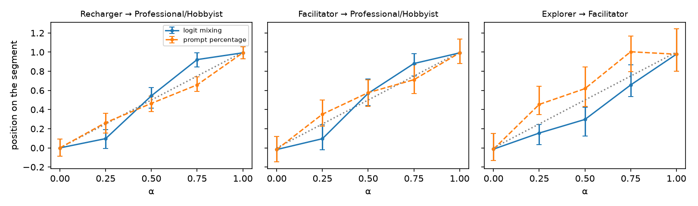
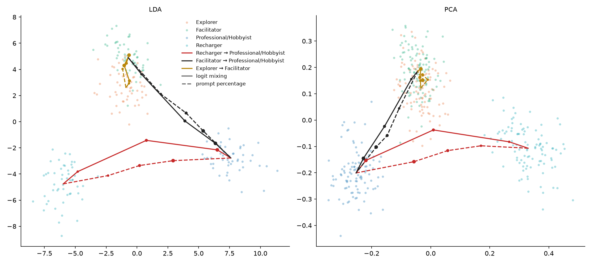
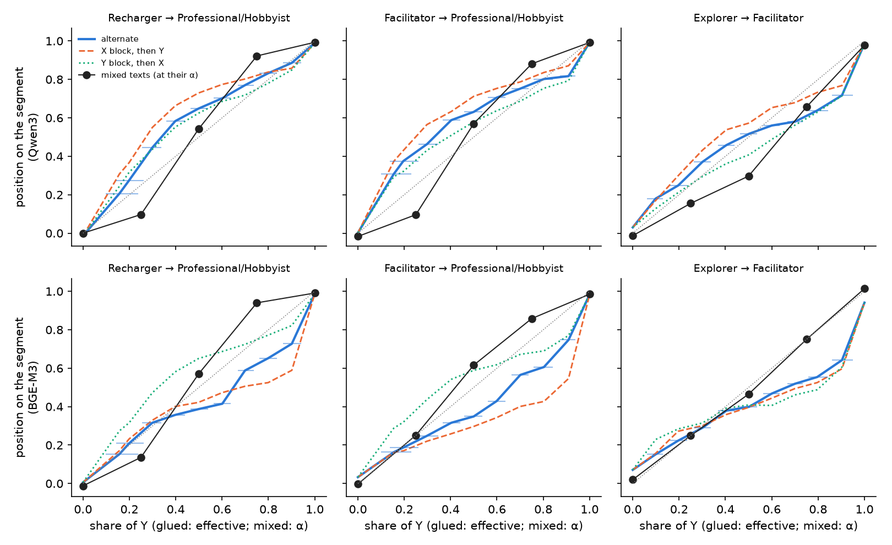

# Museumbot — prove sulla miscela (fuori dalla tesi)

*Ultimo aggiornamento: 10 novembre 2026. Il report descrive solo lo stato attuale del codice e
dei risultati; le decisioni nel tempo sono in `docs/decisioni.md`. Raccoglie le prove fatte
sui testi misti di Gemma 4 31B dopo il corpus misto a α = 0.25, 0.5 e 0.75, che non entrano
in tesi se non come breve paragrafo sugli approcci alternativi. Generatore, testi puri,
corpus misto, posizione sul segmento e probe a 4 classi sono in `docs/report-gemma.md` (§1–§4),
a cui si rimanda per il metodo. Numeri fra parentesi: embedding BGE-M3 (fuori: Qwen3).*

**Domanda.** Nel corpus misto la categoria con più peso prende quasi tutto il testo: a
α = 0.25 e 0.75 i misti stanno vicino ai testi puri (`report-gemma.md` §4). Le prove di questo
report chiedono se dichiarare le percentuali nel prompt funziona meglio (§2), dove sta sul
segmento un testo con una quota nota delle due categorie (§3), e se varianti della miscela o
un α in ingresso diverso spostano i misti verso la loro α (§4, §5).

## 1. Dati e codice

| prova | codice | output |
|---|---|---|
| testi a percentuale | `common/prompts.py` (`pct_block`), `generation/vllm_pct.py`, `kaggle/pct`, `kaggle/pct-retry` | `data/local/prompted.jsonl`: 900 testi, le tre coppie × α = 0.25, 0.5, 0.75 × 100 opere |
| analisi della percentuale | `rq1_embeddings/mixed.py --method pct`, `mixed_space.py --method pct` | `data/emb/pct/`, `results/mixed_pct_*.json`, `mixed_space_pct_*.json`; figure `mixed_compare_*`, `mixed_space_pct_qwen.png` |
| taratura del segmento | `rq1_embeddings/mixed_calib.py` | `data/emb/mixed_calib/`, `results/mixed_calib_*.json`, figura `mixed_calib.png` |
| opere dei piloti | `rq1_embeddings/mixed_pick.py` | `data/local/mixq_pilot.json`: 10 opere per coppia |
| ingresso della minoranza | `generation/mixing.py`, `vllm_mix.py` (`--dstar`), `kaggle/mixq` | `data/local/mixed_q.jsonl` (60 testi) |
| ingresso con veto | `vllm_mix.py --dstar --veto`, `kaggle/mixqv` | `data/local/mixed_qv.jsonl` (60 testi) |
| debito della minoranza | `vllm_mix.py --debt`, `kaggle/mixd` | `data/local/mixed_d.jsonl` (60 testi) |
| miscela classica a α = 0.4 e 0.6 | `vllm_mix.py`, `kaggle/mix46` | `data/local/mixed_46.jsonl` (60 testi del pilota) |

Stessa configurazione di generazione dei testi misti (`report-gemma.md` §1). Tutti i testi dei
piloti sono validi.

## 2. Testi a percentuale nel prompt

Codice e dati: `common/prompts.py`, `generation/vllm_pct.py`,
`data/local/prompted.jsonl`. Un confronto descrittivo, senza criteri né soglie: la miscela
passo per passo aggiunge qualcosa rispetto a dichiarare i pesi nel prompt? Le stesse tre
coppie (stesso ordine X → Y), α = 0.25, 0.5, 0.75 e le stesse 100 opere (900 testi) si
generano con un solo prompt, normale generazione di vLLM, stessa configurazione dei testi
puri. Cambia solo il blocco di categoria; template e riga contro il Markdown restano uguali.
Per Explorer → Facilitator a α = 0.25 il blocco è:

> Your listener is 75% an Explorer and 25% a Facilitator. An Explorer is … A Facilitator is …
> Weigh the two profiles in the guide in this proportion: 75% Explorer, 25% Facilitator.

Le due definizioni sono i blocchi `full` delle categorie, senza modifiche, sempre X prima di
Y. Non ci sono testi a α = 0 e 1: i vertici sono i testi puri.

- **Conteggi.** 238 testi su 900 sono stati rigenerati almeno una volta (miscela: 59 su 900).
  33, tutti in Facilitator → Professional/Hobbyist (22 a α = 0.25, 2 a 0.5, 9 a 0.75),
  hanno richiesto da 13 a 165 tentativi, quasi sempre per "For those…"; per loro le
  violazioni dal 12° tentativo in poi sono in `usage.violations` (787 tentativi scartati).
  Tutti i 900 testi sono validi, n = 100 in ogni cella. La lunghezza mediana è 230 parole
  (miscela: 224.5). Nessun testo cita percentuali o nomi di categoria.

**Posizione mediana per α**, Qwen3 (BGE-M3), per miscela (m) e percentuale (p); Spearman fra
α e posizione con i puri ai vertici (`results/mixed_{qwen,bge-m3}.json`,
`results/mixed_pct_{qwen,bge-m3}.json`):

| coppia | metodo | 0.25 | 0.5 | 0.75 | Spearman |
|---|---|---|---|---|---|
| Recharger → Prof./Hobbyist | m | 0.10 (0.14) | 0.54 (0.57) | 0.92 (0.94) | 0.91 (0.90) |
| | p | 0.26 (0.12) | 0.47 (0.36) | 0.66 (0.53) | 0.93 (0.88) |
| Facilitator → Prof./Hobbyist | m | 0.10 (0.25) | 0.57 (0.62) | 0.88 (0.86) | 0.88 (0.88) |
| | p | 0.35 (0.26) | 0.58 (0.57) | 0.71 (0.81) | 0.85 (0.88) |
| Explorer → Facilitator | m | 0.16 (0.25) | 0.30 (0.47) | 0.66 (0.75) | 0.82 (0.77) |
| | p | 0.45 (0.27) | 0.62 (0.48) | 1.00 (0.92) | 0.77 (0.79) |

**Probe a 4 classi sui testi a percentuale** (`mixed_space.py --method pct`,
`results/mixed_space_pct_{qwen,bge-m3}.json`), stesso layout della tabella dei misti in `report-gemma.md` §4:
quota di testi assegnati a X, a Y e alle altre due categorie.

*Qwen3*

| coppia (X → Y) | α = 0.25 (X / Y / altre) | α = 0.5 (X / Y / altre) | α = 0.75 (X / Y / altre) |
|---|---|---|---|
| Recharger → Prof./Hobbyist | 0.95 / 0.02 / 0.03 | 0.53 / 0.30 / 0.17 | 0.08 / 0.89 / 0.03 |
| Facilitator → Prof./Hobbyist | 0.59 / 0.25 / 0.16 | 0.24 / 0.68 / 0.08 | 0.03 / 0.93 / 0.04 |
| Explorer → Facilitator | 0.49 / 0.50 / 0.01 | 0.26 / 0.74 / 0.00 | 0.03 / 0.97 / 0.00 |

*BGE-M3*

| coppia (X → Y) | α = 0.25 (X / Y / altre) | α = 0.5 (X / Y / altre) | α = 0.75 (X / Y / altre) |
|---|---|---|---|
| Recharger → Prof./Hobbyist | 1.00 / 0.00 / 0.00 | 0.87 / 0.06 / 0.07 | 0.40 / 0.50 / 0.10 |
| Facilitator → Prof./Hobbyist | 0.71 / 0.13 / 0.16 | 0.12 / 0.85 / 0.03 | 0.00 / 1.00 / 0.00 |
| Explorer → Facilitator | 0.85 / 0.14 / 0.01 | 0.46 / 0.54 / 0.00 | 0.04 / 0.95 / 0.01 |

- **Coppie contrapposte: la percentuale sale più piano.** Nel Recharger → Prof./Hobbyist
  la mediana dei testi a percentuale a α = 0.75 sta a 0.66 (0.53) contro 0.92 (0.94) della
  miscela, e a 0.5 a 0.47 (0.36) contro 0.54 (0.57). Nel Facilitator → Prof./Hobbyist le due
  curve coincidono a 0.5 con BGE-M3 (0.57, 0.62) e con Qwen3 (0.58, 0.57); a 0.25 con Qwen3
  la percentuale sta a 0.35 contro 0.10. Lo Spearman differisce di al più 0.03 nelle due
  coppie con Qwen3 e di 0.02 con BGE-M3.
- **Coppia vicina: la percentuale supera la diagonale.** Con Qwen3 le mediane dei testi a
  percentuale (0.45, 0.62, 1.00) stanno sopra α a ogni livello, quelle della miscela (0.16,
  0.30, 0.66) sotto o vicino. Con BGE-M3 coincidono a 0.25 e 0.5 (0.27, 0.48 contro 0.25,
  0.47), a 0.75 la percentuale arriva a 0.92 (miscela 0.75). L'intervallo interquartile è
  largo per entrambi i metodi (segmento corto).
- **Nel probe i testi a percentuale lasciano meno la coppia, ma separano meno.** A α = 0.5
  la quota assegnata alle altre due categorie nel Recharger → Prof./Hobbyist è 0.17 con
  Qwen3 e 0.07 con BGE-M3, contro 0.46 e 0.20 della miscela. Agli estremi la quota assegnata
  alla categoria più vicina è più bassa: Facilitator → Prof./Hobbyist a α = 0.25, X 0.59
  (0.71) contro 0.88 (0.81); Explorer → Facilitator a 0.25 con Qwen3, X 0.49 e Y 0.50 contro
  0.97 e 0.03.
- **I testi rigenerati a lungo.** In Facilitator → Prof./Hobbyist 33 testi sono validi solo
  dopo molti tentativi: sono i testi che il modello, con quel prompt, tende a scrivere con
  "For those…", e quelli tenuti sono i rari che non lo fanno.

Limiti: nei testi a percentuale l'ordine è fisso (X prima di Y nel prompt), quindi la
categoria citata per prima potrebbe pesare di più a parità di percentuale; 33 testi
(Facilitator → Prof./Hobbyist) sono validi solo dopo 13–165 tentativi, quindi in quelle
celle il filtro seleziona i testi.

## 3. Taratura del segmento con miscele note

Codice e dati: `rq1_embeddings/mixed_calib.py`, `results/mixed_calib_*.json`;
spec in `docs/plans/2026-11-03-taratura-segmento-design.md`. Dove mette l'embedding un testo
con una quota nota di X e di Y? Per ogni opera e coppia si prendono l'inizio del testo puro
di X e la fine del testo puro di Y (replica `full_rep`, tagli a fine frase), con circa
(1 − α) e α della lunghezza, α = 0.1, 0.2, …, 0.9, e si compongono in tre modi: `alt` (frasi
dei due pezzi alternate in modo uniforme, come si alternano i registri nei misti), `XY` e
`YX` (un blocco dopo l'altro, nei due ordini). 8100 testi, collocati sul segmento come i
misti (steering vector da `full`). Una frase pesa in mediana l'8.6% del testo, quindi la
quota effettiva di Y si scosta da α di circa ±0.04 (dal 5° al 95° percentile); a α = 0.1 il
minimo di una frase per pezzo la alza a 0.10–0.16.

Posizione mediana dei testi incollati `alt` per α, Qwen3 (BGE-M3), e quota effettiva media:

| coppia | 0.1 | 0.2 | 0.3 | 0.4 | 0.5 | 0.6 | 0.7 | 0.8 | 0.9 |
|---|---|---|---|---|---|---|---|---|---|
| Recharger → Prof./Hobbyist | 0.21 (0.15) | 0.28 (0.21) | 0.45 (0.32) | 0.58 (0.36) | 0.65 (0.39) | 0.70 (0.41) | 0.77 (0.59) | 0.83 (0.65) | 0.89 (0.73) |
| quota effettiva | 0.16 | 0.20 | 0.30 | 0.40 | 0.50 | 0.60 | 0.70 | 0.80 | 0.90 |
| Facilitator → Prof./Hobbyist | 0.31 (0.16) | 0.38 (0.19) | 0.46 (0.25) | 0.59 (0.32) | 0.63 (0.35) | 0.70 (0.43) | 0.75 (0.56) | 0.80 (0.61) | 0.82 (0.75) |
| quota effettiva | 0.15 | 0.20 | 0.30 | 0.40 | 0.50 | 0.60 | 0.70 | 0.80 | 0.91 |
| Explorer → Facilitator | 0.18 (0.15) | 0.25 (0.22) | 0.37 (0.29) | 0.46 (0.38) | 0.52 (0.40) | 0.56 (0.47) | 0.58 (0.52) | 0.64 (0.55) | 0.72 (0.64) |
| quota effettiva | 0.10 | 0.20 | 0.30 | 0.40 | 0.50 | 0.60 | 0.70 | 0.80 | 0.90 |

I testi puri interi di `full_rep` cadono a −0.01–0.07 (X) e 0.94–0.99 (Y).

- **Con Qwen3, nelle coppie contrapposte, i testi incollati stanno sopra la diagonale**,
  cioè verso Professional/Hobbyist: in media +0.09 e +0.10 rispetto alla quota effettiva
  (`alt`), fino a +0.18 fra quota 0.3 e 0.5, e si riavvicinano alla diagonale a 0.8–0.9.
  Bastano poche frasi di Professional/Hobbyist per spostare molto il testo. Nella coppia
  vicina la curva sta sopra fino a 0.5 e sotto dopo (in media −0.03).
- **Con BGE-M3 stanno sotto la diagonale**, verso X: in media −0.08, −0.11 e −0.10 (`alt`),
  sulla diagonale fino a quota 0.3–0.4; solo `YX` sta sopra (+0.04…+0.08).
- Lo Spearman fra quota effettiva e posizione è 0.52–0.87 con Qwen3 e 0.28–0.74 con BGE-M3:
  la posizione del singolo testo incollato è rumorosa, la curva delle mediane sale con
  regolarità.
- **L'ordine dei blocchi pesa, in verso opposto nei due modelli.** Con Qwen3 conta di più la
  parte finale (`XY`, con Y in fondo, sta più verso Y di `YX`); con BGE-M3, nelle coppie
  contrapposte, la parte iniziale (nella coppia vicina i due ordini quasi coincidono).
  È coerente con il modo in cui i due modelli riassumono il testo: l'ultimo token per
  Qwen3-Embedding, il primo (CLS) per BGE-M3.

**Quota equivalente dei misti**: la quota di Y dei testi incollati che cade nella stessa
posizione mediana dei misti, per interpolazione sulla curva (vertici compresi); `alt`, e fra
parentesi `XY` / `YX`.

| coppia | α | Qwen3 | BGE-M3 |
|---|---|---|---|
| Recharger → Prof./Hobbyist | 0.25 | 0.08 (0.05 / 0.07) | 0.14 (0.12 / 0.08) |
| | 0.5 | 0.37 (0.30 / 0.39) | 0.69 (0.87 / 0.39) |
| | 0.75 | 0.94 (0.95 / 0.95) | 0.98 (0.99 / 0.97) |
| Facilitator → Prof./Hobbyist | 0.25 | 0.05 (0.04 / 0.05) | 0.30 (0.38 / 0.13) |
| | 0.5 | 0.39 (0.31 / 0.49) | 0.81 (0.92 / 0.59) |
| | 0.75 | 0.94 (0.92 / 0.95) | 0.95 (0.97 / 0.95) |
| Explorer → Facilitator | 0.25 | 0.08 (0.09 / 0.13) | 0.24 (0.18 / 0.13) |
| | 0.5 | 0.24 (0.19 / 0.30) | 0.60 (0.64 / 0.71) |
| | 0.75 | 0.82 (0.61 / 0.83) | 0.94 (0.95 / 0.94) |

- **Agli estremi i misti sono più netti della loro α, con entrambi gli embedding.** Un misto a
  α = 0.25 sta dove sta un testo con il 5–8% di Y (Qwen3) o il 14–30% (BGE-M3); uno a 0.75
  dove sta un testo con l'82–94% (Qwen3) o il 94–98% (BGE-M3). La categoria con più peso
  prende quasi tutto il testo. Molti di questi valori cadono fuori dai testi incollati (fra
  il vertice e la quota 0.1 o 0.9): lì la quota equivalente è un'interpolazione lineare fino
  al testo puro.
- **A α = 0.5 i due embedding non sono d'accordo**: con Qwen3 il misto vale una quota di Y di
  0.24–0.39 (pende verso X), con BGE-M3 di 0.60–0.81 (pende verso Y), e con BGE-M3 i due
  ordini danno valori lontani fra loro (0.39 e 0.87 nel Recharger → Prof./Hobbyist). La curva
  di BGE-M3 è più piatta, quindi una piccola differenza di posizione diventa una grande
  differenza di quota. Il punto di equilibrio dei misti resta indeterminato.
- Limiti: i testi incollati hanno attacchi e salti che i misti non hanno. `alt` comincia
  sempre con la prima frase di X e finisce con il pezzo più lungo, quindi non è neutra
  rispetto all'ordine per un modello che pesa l'inizio (BGE-M3) o la fine (Qwen3) del testo.
  La taratura dice dove l'embedding mette una quota nota di testo, non dove starebbe un
  misto ideale.

## 4. Varianti della miscela a token (piloti)

Tre varianti della miscela geometrica, per far vincere alla categoria a peso minore (la
*minoranza*) la sua parte dei token su cui i due esperti non sono d'accordo. Pilota comune: le
tre coppie, α = 0.25 e 0.75, 10 opere per coppia vicine alla media dei misti
(`mixed_pick.py`), stessi seed dei misti: 60 testi per variante.

- **Ingresso della minoranza** (`mixq`): a ogni token, con probabilità q(α), sceglie da sola
  la minoranza; altrimenti la miscela di sempre. q è tarato perché la minoranza vinca la sua
  quota a distanza d* = 4 fra i due esperti: q(0.25) = q(0.75) = 0.148, q = 0 a α = 0.5. Spec
  `docs/plans/2026-11-04-ingresso-minoranza-design.md`.
- **Ingresso con veto della maggioranza** (`mixqv`): come sopra, ma nei passi della minoranza
  si pesca solo fra i suoi token che sono anche fra le prime 100 della maggioranza.
- **Debito della minoranza** (`mixd`): nessun passo deciso dalla sola minoranza. Un passo è
  conteso se il token scelto ha |log p_X − log p_Y| ≥ 3; a ogni contesa il debito cresce di m
  (il peso della minoranza) e cala di 1 se vince la minoranza; il peso della minoranza nella
  media geometrica è min(m + 0.25 · debito, 0.5). Spec
  `docs/plans/2026-11-05-debito-minoranza-design.md`.

L'ingresso senza veto è escluso dalle prove successive perché spezza alcune frasi
(`docs/decisioni.md`). Stato: testi generati; l'analisi secondo i criteri delle spec è stata
fatta solo in modo esplorativo, fuori dal codice, quindi qui non ci sono ancora risultati.

## 5. Miscela classica a α = 0.4 e 0.6 (pilota)

Invece di cambiare la miscela si cambia solo α in ingresso, con due valori di prova: 0.4 e
0.6. Non sono ricavati dalla taratura (§3): le stime che se ne leggono per le quote 0.25 e
0.75 non concordano fra i due embedding, e la taratura non dà il legame fra α (parametro del
generatore) e quota (lettura dell'embedder). Pilota sulle stesse 10 opere per coppia, spec
`docs/plans/2026-11-06-miscela-alpha-inversa-design.md`. Stato: testi generati; analisi solo
esplorativa, fuori dal codice. Il corpus completo a questi due α (100 opere) e le posizioni
sul segmento sono in `report-gemma.md` §4.

**Quota equivalente dei misti del corpus completo** (`mixed_tuned.py`,
`results/mixed_tuned_*.json`, curva `alt`), Qwen3 (BGE-M3):

| coppia | α = 0.25 | α = 0.4 | α = 0.6 | α = 0.75 |
|---|---|---|---|---|
| Recharger → Prof./Hobbyist | 0.08 (0.14) | 0.16 (0.26) | 0.79 (0.94) | 0.94 (0.98) |
| Facilitator → Prof./Hobbyist | 0.05 (0.30) | 0.17 (0.65) | 0.60 (0.89) | 0.94 (0.95) |
| Explorer → Facilitator | 0.08 (0.24) | 0.17 (0.37) | 0.39 (0.80) | 0.82 (0.94) |

Con le stesse posizioni, i due embedding danno quote diverse (per esempio 0.17 e 0.65 a 0.4 in
Facilitator → Prof./Hobbyist): la quota equivalente dipende dall'embedder e non si usa per
valutare α.

## 6. Come leggere i testi misti

Le letture qualitative fatte finora (letture dirette e confronti al buio con un altro agente)
contavano soprattutto le formule tipiche di una categoria, per esempio l'invito a discutere
con i compagni per il Facilitator. La fonte è la stessa per tutti i testi di un'opera, quindi
la lettura deve guardare lo spostamento di stile (registro, lunghezza e densità delle frasi,
tipo di domanda, a chi si rivolge il testo) rispetto ai due testi puri della stessa opera.
Le letture con le formule come metro non si usano più; quelle con i puri come riferimento sono
da fare.

## 7. Proposte non implementate

- **Alternanza per frase.** α fissa la quota di frasi assegnate alla minoranza; dentro una
  frase l'esperto che la possiede ha peso alto (per esempio 0.85) e l'altro il resto. Confine
  di frase: il testo generato finisce con `.`, `!` o `?` (con virgolette o parentesi di
  chiusura facoltative) o con un a capo, ma non dopo un'iniziale maiuscola, un'abbreviazione
  di una lista (St, Dr, Mr, Mrs, Jr, c, ca, vs, No, Mt) o una sigla con punti interni.
  Porterebbe alla minoranza anche i tratti che la miscela a token perde (per esempio il
  rivolgersi al gruppo), ma avvicina il testo ai blocchi.
- **Dalla letteratura.** L'operatore di unione di *model arithmetic* (Dekoninck et al., 2024;
  la miscela geometrica è il loro operatore di base), la guida senza classificatore per LLM
  (Sanchez et al., 2023), DExperts, la pianificazione dello stile per frase (Hua e Wang,
  2019), l'ensemble per span (SweetSpan, 2025), i vettori di steering (EasySteer) e
  l'interpolazione di vettori di persona, dove una persona domina quasi tutto l'intervallo di
  α (Creative Collision, 2026).

## 8. Prossimi passi

1. Portare nel codice l'analisi dei piloti (§4, §5): contese vinte dalla minoranza, frasi
   rotte, quota equivalente, con entrambi i modelli; risultati in `results/`.
2. Leggere i misti accanto ai due puri della stessa opera (§6), per miscela classica, veto,
   debito e percentuale.
